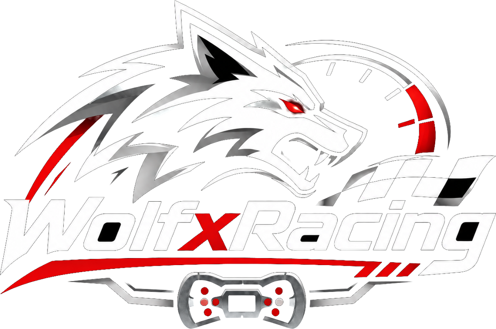
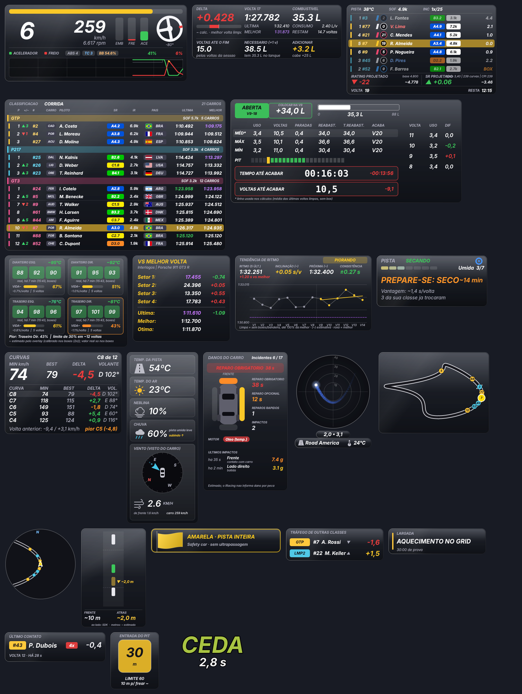
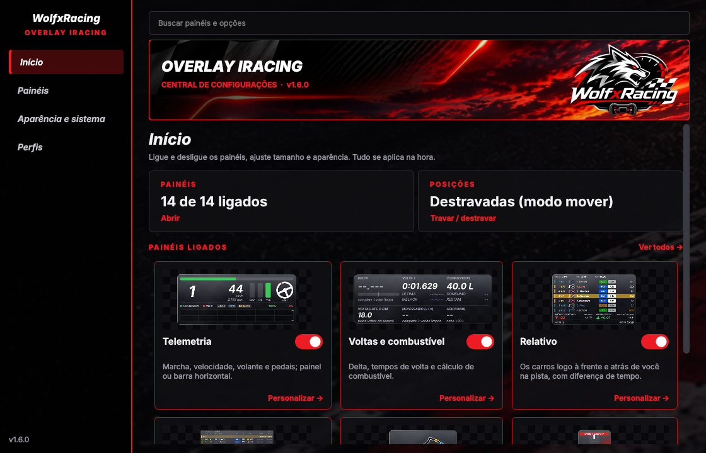
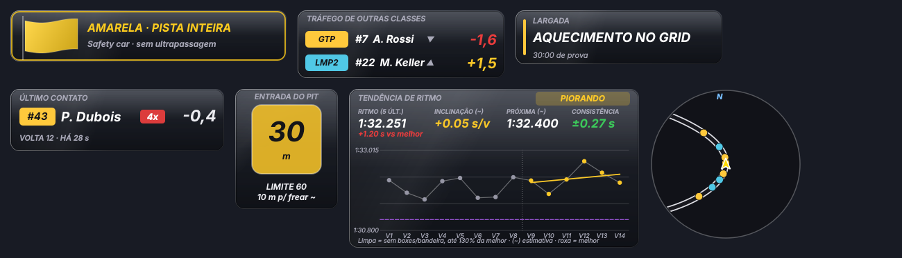
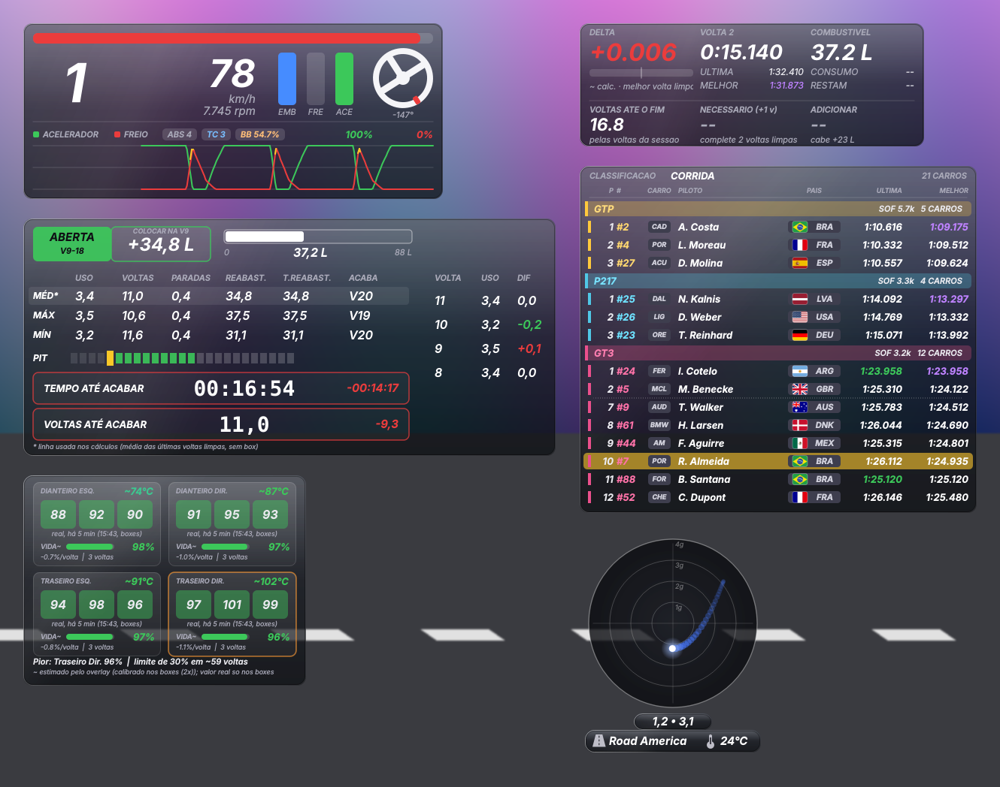
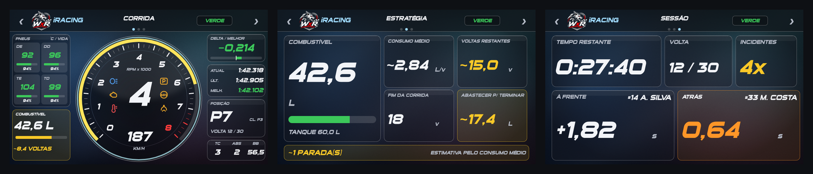
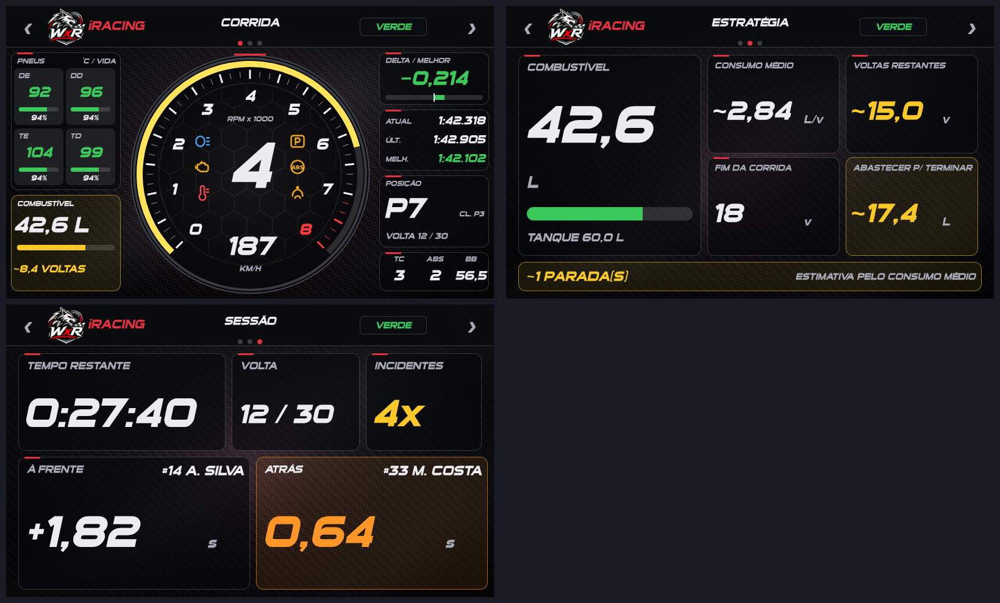

# WolfxRacing Overlay para iRacing

Overlay gratuito e de código aberto para **iRacing** no Windows, com **24 janelas** independentes, **dash para o Simagic MagicDash 4** (SimHub) e **perfil de Stream Deck XL**.

> Projeto da comunidade, sem vínculo com a iRacing.com Motorsport Simulations, Simagic, SimHub ou Elgato. Marcas pertencem aos seus donos. O overlay **não injeta código no jogo**: lê apenas a telemetria que o próprio jogo disponibiliza.

## O que tem aqui

| Pasta | Conteúdo |
|---|---|
| [`overlay/`](overlay) | O overlay (Python + PySide6): 24 janelas, perfis, atalhos globais, testes automáticos |
| [`dash/`](dash) | Dash **MagicDash 4** nos estilos **Glass Fumê** e **Sport** (`.simhubdash`, 3 telas, 800x480) + ferramentas para gerar/alterar |
| [`streamdeck/`](streamdeck) | Perfil para **Stream Deck XL**, biblioteca de ícones e gerador |
| [`docs/`](docs) | Manual, guia do dash, guia do Stream Deck, arquitetura e histórico |

## Novidades da 1.6.0

**Central de configurações** (janela única para ligar/desligar painéis, ajustar aparência e atalhos), **Tendência de ritmo** (inclinação do ritmo, previsão da próxima volta e consistência), **Último contato**, **Entrada do pit**, minimapa rotativo mais fluido e novas janelas automáticas de bandeiras, tráfego e auxiliar.

## Estilos visuais: Glass Fumê e Sport

O overlay e o dash têm dois estilos. **Glass Fumê** (novo, padrão) é um vidro escuro translucido, com reflexo suave e bordas finas; **Sport** usa fibra de carbono e detalhes vermelhos. Os dois têm a **tipografia esportiva** (texto itálico, Sui Generis nos títulos). No overlay, troque em *bandeja > Estilo Glass Fumê / Estilo Sport*. No dash, importe o arquivo `Glass` ou `Sport`.

### Dash MagicDash 4 Glass Fumê

### Dash MagicDash 4 Sport

## Início rápido

> Baixou o zip? Leia primeiro o **COMECE_AQUI.txt** (texto simples, 2 minutos).

1. Baixe o `.zip` da página de [Releases](../../releases) e extraia dentro de `C:\WolfxRacing` (o zip cria a pasta `wolfxracing-overlay-iracing`; recomendado; o perfil do Stream Deck assume este caminho, mas dá para ajustar).
2. Dê duplo clique em **`overlay\instalar.bat`** (uma vez) e depois em **`overlay\testar_demo.bat`** para ver o overlay funcionando com dados simulados.
3. Configure o jogo e abra o overlay com **`overlay\iniciar_overlay.bat`**.
4. Dash: dê duplo clique em `dash\MagicDash4 iRacing Glass.simhubdash` (ou `...Sport.simhubdash`; o SimHub importa).
5. Stream Deck (opcional): importe `streamdeck\Overlay iRacing.streamDeckProfile`.

> **Sem Python?** A release traz também o `WolfxRacing_iRacing_vX.Y.Z_EXE.zip` (versão EXE): extraia e abra o `.exe`, sem instalar nada. O Windows pode avisar (SmartScreen) porque o EXE não tem assinatura paga: "Mais informações" > "Executar assim mesmo".

Passo a passo completo e com prints: **[docs/MANUAL.md](docs/MANUAL.md)**.

## Requisitos

- Windows 10/11 (64 bits).
- Python **3.12** (64 bits) com `pyirsdk` e `PySide6-Essentials` (o `instalar.bat` faz isso), **ou** a versão EXE, que dispensa o Python.
- iRacing em **janela sem bordas** (aba Display: desmarque *Full Screen* e *Border*). Em tela cheia exclusiva o Windows não deixa nenhum overlay aparecer.
- Dash: SimHub (testado com 9.x) e um Simagic MagicDash 4 (ou qualquer tela 800x480 do SimHub).
- Stream Deck: modelo XL (32 teclas).

## Documentação

- [Manual do usuário](docs/MANUAL.md) · [Dash](docs/DASH.md) · [Stream Deck](docs/STREAMDECK.md)
- [Arquitetura (para quem quer contribuir)](docs/ARQUITETURA.md) · [Como contribuir](CONTRIBUTING.md) · [Histórico de versões](CHANGELOG.md)
- [Histórico do desenvolvimento](docs/historico)

## Contribuindo

Melhorias são muito bem-vindas: abra uma *Issue* com o problema ou a ideia, ou envie um *Pull Request*. Leia o [CONTRIBUTING](CONTRIBUTING.md) (como rodar os testes, padrões e o que **não** incluir, como logos de marcas).

## Licença

[MIT](LICENSE). Componentes de terceiros e avisos em [NOTICE.md](NOTICE.md).

---
**English summary:** free, open-source overlay for iRacing (Windows, Python/PySide6) with 17 windows, a SimHub dash for the Simagic MagicDash 4 and a Stream Deck XL profile. Documentation is in Brazilian Portuguese; contributions in English or Portuguese are welcome.
