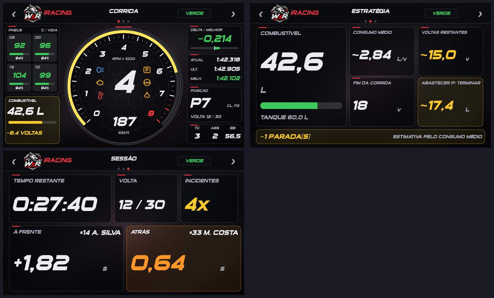
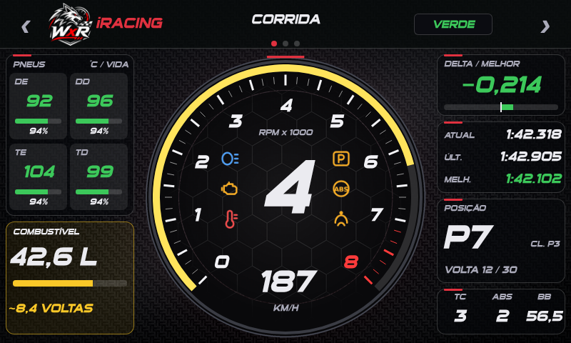
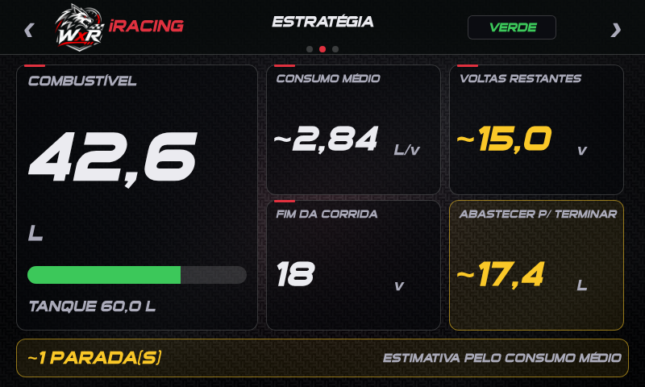
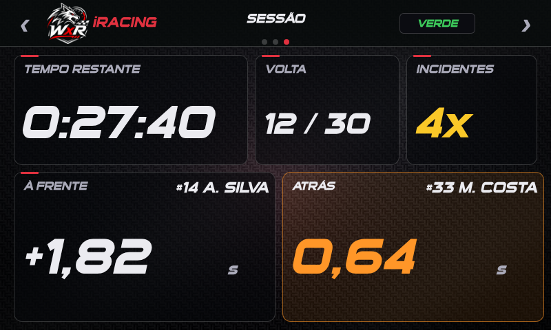

# Dash MagicDash 4 Sport para iRacing

Dash para o **Simagic MagicDash 4** (800x480, tela de toque) feito no SimHub (Dash Studio), em estilo de painel de carro esportivo: fundo de fibra de carbono, fonte inclinada **Sui Generis** (já vem com o SimHub), detalhes vermelhos e luzes de aviso dentro do tacômetro.



> O cabeçalho traz o emblema **WolfxRacing** e o nome do jogo em texto. Os prints são **prévias com dados de exemplo**, geradas fora do SimHub; o dash real pode ter pequenas diferenças. Os logos oficiais do jogo **não** são distribuídos (marcas registradas): no lugar fica o emblema WolfxRacing, com o nome do jogo em texto.

## Instalação

1. Requisitos: SimHub 9.x (testado com 9.13) e o MagicDash 4 configurado no SimHub.
2. Dê **duplo clique** em `dash/MagicDash4 iRacing Sport.simhubdash`: o SimHub importa o dash (ou: *Dash Studio > Import/Add dashboard*).
3. Em *Dash Studio*, selecione **MagicDash4 iRacing Sport** como *Main dashboard* do MagicDash 4.
4. Reimportar sobrescreve a versão anterior.

## Navegação

O SimHub não tem gesto de deslizar: toque na **metade esquerda do cabeçalho** para a tela anterior e na **metade direita** para a próxima (com volta ao início). Os pontos no cabeçalho indicam a tela atual.

## Telas

### Tela 1: Corrida



Tacômetro central com marcha, velocidade e RPM x1000 (faixa vermelha perto do corte), **6 luzes de aviso** dentro do mostrador (farol, motor, temperatura, limitador de boxes, ABS e TC), pneus (temperatura e vida), combustível (litros, barra, voltas restantes), delta/melhor, tempos atual/última/melhor, posição, volta e ajustes de TC, ABS e balanço de freio.

### Tela 2: Estratégia



Combustível, consumo médio, voltas restantes, fim da corrida (em voltas), quanto abastecer para terminar e número estimado de paradas.

### Tela 3: Sessão



Tempo restante, volta atual/total, incidentes e o gap para o carro à frente e o de trás.

## Notas

- O dial acompanha o limite de giros do carro (escala dinâmica; funciona também com mais de 8.000 rpm).
- A temperatura dos pneus no iRacing é **estimada** pelo script `MD4_iracing_pneus.js` (o iRacing só informa valores reais com o carro parado nos boxes). Há uma calibração em andamento; contribuições são bem-vindas.
- Valores com `~` são calculados/estimados; sem `~` são medidos pelo jogo.
- Em itens sem dado do jogo o dash mostra `--` (nada é inventado).

## Alterar ou gerar o dash

O `.simhubdash` é gerado por scripts Python em [`dash/tools`](../dash/tools) (requer `pillow`, `numpy`; `playwright` só para as prévias):

```text
cd dash/tools
python bg_sport.py && python bg_sport2.py   # fundos (opcional: já vêm em assets_sport/)
python icons_sport.py                       # ícones das luzes (opcional)
python build_sport.py --so iracing              # gera out_sport/MagicDash4 iRacing Sport.simhubdash
python check_sport.py                       # valida o resultado
```

Opções do `build_sport.py`: `--so iracing|lmu|todos` e `--com-logos` (somente para **uso pessoal**: troca o emblema WolfxRacing pelo logo do jogo; coloque o seu `MD4_logo_<jogo>.png` em `assets_sport/`; não publique o resultado). As expressões (JavaScript do SimHub) ficam em `js_sport/`: `MD4_alertas.js` (luzes, posição, energia), `MD4_iracing_pneus.js` (pneus).

Dicas de desenvolvimento: abra o dash no navegador em `http://127.0.0.1:8888/Dash?r=1#<NomeDoDash>` (SimHub em execução) para ver as telas ao vivo e testar `$prop(...)` nas expressões.
