# Manual do usuário: WolfxRacing Overlay para iRacing

> Versão do overlay neste pacote: **1.2.0** (Fase 20.2.2 + estilos Glass Fumê e Sport + gráfico de pedais na Telemetria, Luz ABS, Luz TC, Retorno à pista e Estratégia de pneus). Os prints foram gerados no **modo demonstração** (dados simulados); as fontes e as medidas podem variar um pouco no seu Windows.

## Sumário

1. [O que é](#1-o-que-é) · 2. [Instalação](#2-instalação-uma-única-vez) · 3. [Configurar o jogo](#3-configurar-o-iracing) · 4. [Uso diário](#4-uso-diário) · 5. [As 24 janelas](#5-as-janelas) · 6. [Como ler os números](#6-como-ler-os-números) · 7. [Dash e Stream Deck](#7-dash-e-stream-deck) · 8. [Solução de problemas](#8-solução-de-problemas) · 9. [Atualizar](#9-atualizar-para-uma-versão-nova) · 10. [Limites](#10-limites-conhecidos)

## 1. O que é

24 janelas independentes e transparentes, sempre por cima do jogo, que podem ser movidas, redimensionadas e ligadas/desligadas pelo menu do ícone vermelho "i" perto do relógio do Windows. Tudo roda localmente; nenhum dado seu é enviado para a internet.

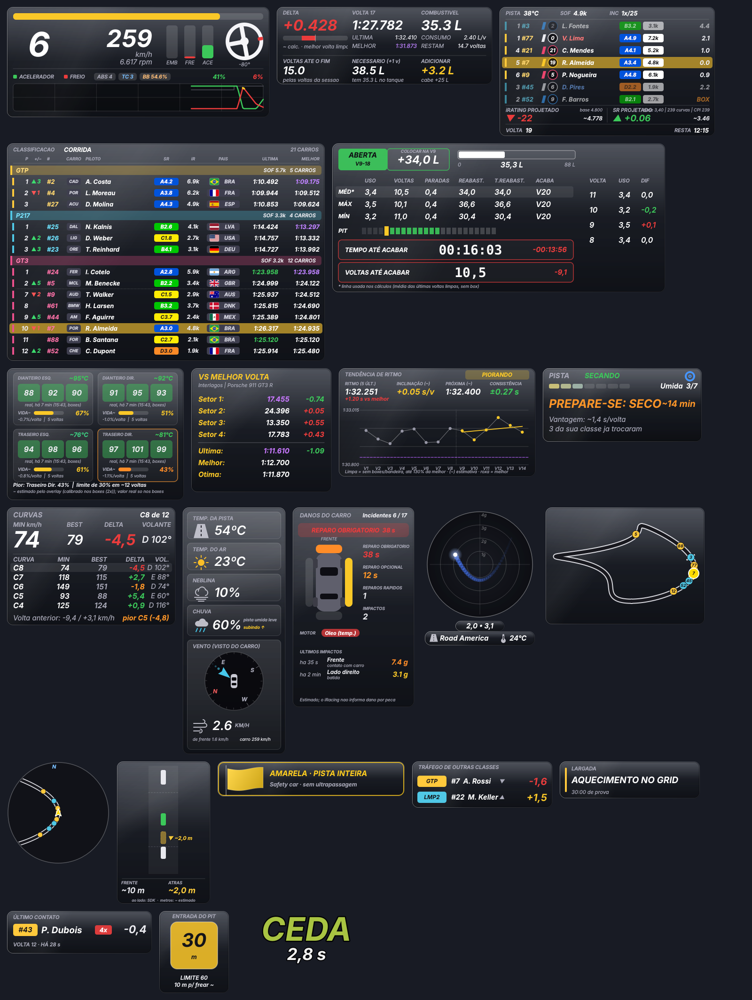

## 2. Instalação (uma única vez)

1. **Python 3.12.** Instale o *Python Install Manager* em [python.org/downloads](https://www.python.org/downloads/).
2. **Extraia** o `.zip` dentro de `C:\WolfxRacing` (o zip já cria a pasta `wolfxracing-overlay-iracing`; o resultado é `C:\WolfxRacing\wolfxracing-overlay-iracing`). Outra pasta também funciona, mas veja o aviso do Stream Deck em [STREAMDECK.md](STREAMDECK.md).
3. Dê duplo clique em **`overlay\instalar.bat`**. Ele prepara o Python 3.12 e instala `pyirsdk` e `PySide6-Essentials`. Aguarde "Instalação concluída".
4. Teste sem o jogo: **`overlay\testar_demo.bat`** (dados simulados, nomes fictícios). Procure o ícone vermelho "i" perto do relógio do Windows (pode estar na seta `^`).

Instalação manual (alternativa): `py -3.12 -m pip install pyirsdk PySide6-Essentials`.

## 3. Configurar o iRacing

- Vídeo em **janela sem bordas**: no iRacing, aba *Display*, desmarque *Full Screen* e *Border* e reinicie o jogo. Visualmente é idêntico à tela cheia.
- Na tela cheia **exclusiva** o Windows não deixa nenhuma janela de outro programa aparecer sobre o jogo. A única forma de contornar seria injetar código no iRacing, o que **este projeto não faz** (poderia ser tratado como violação das regras do serviço).
- O overlay precisa que o iRacing esteja aberto e **dentro de uma sessão**; antes disso a janela mostra "Aguardando o iRacing..."

## 4. Uso diário

1. Abra **`overlay\iniciar_overlay.bat`** (pode ser antes ou depois do jogo).
2. **Posicionar as janelas:** clique com o botão direito no ícone vermelho "i" e **desmarque "Travar posição"**. Janelas destravadas ganham contorno amarelo: arraste para onde quiser. Ao terminar, marque "Travar posição" (os cliques passam a atravessar o overlay).
3. **Redimensionar:** com a posição destravada, arraste uma **borda** (muda só largura ou só altura) ou um **canto** (muda as duas, mantendo a proporção); ou segure **Ctrl** e gire a roda do mouse. *Restaurar o tamanho das janelas (100%)* volta ao padrão.
4. **Aparecer sozinho:** com a posição travada, as janelas aparecem quando você entra no carro e somem 6 s depois de sair (garagem, menu, replay). Para ficarem sempre visíveis, desmarque *Aparecer sozinho ao entrar no carro*.
5. **Iniciar com o Windows:** `ativar_inicio_automatico.bat` (e `desativar_inicio_automatico.bat` para desfazer).
6. **Perfis de exibição** (menu da bandeja > *Perfil de exibição*): **Treino**, **Classificação** e **Corrida** guardam, para cada janela, posição, tamanho e se aparece. *Automático* troca sozinho pelo tipo de sessão (só depois de 3 s estáveis e nunca com as janelas destravadas).
7. **Visual:** *Visual moderno* (carbono, Bahnschrift), **Estilo Glass Fumê** (vidro escuro translúcido, padrão), **Estilo Sport** (itálico, cantos cortados e detalhes vermelhos, igual ao dash Sport) e *Transparência do fundo* (40 a 100%). Desmarcar *Visual moderno* volta ao visual clássico.
8. **Desempenho:** *Modo economia de CPU* (metade das atualizações) e *Prioridade baixa do overlay* (o jogo tem preferência).
9. **Fechar:** *Sair* no menu da bandeja, `Ctrl+Alt+F22` (Stream Deck) ou, se travar, `overlay\fechar_overlay.bat`.

### Estilos visuais

Os dois estilos usam a tipografia esportiva (itálico; títulos em Sui Generis, se o SimHub estiver instalado). Glass Fumê e Sport não se combinam: ao marcar um, o outro desmarca. A *Transparência do fundo* vale para os dois (no Glass Fumê, valores entre 60% e 80% deixam o vidro mais evidente). O vidro é simulado com transparência e reflexos; o overlay não borra o que está atrás da janela.

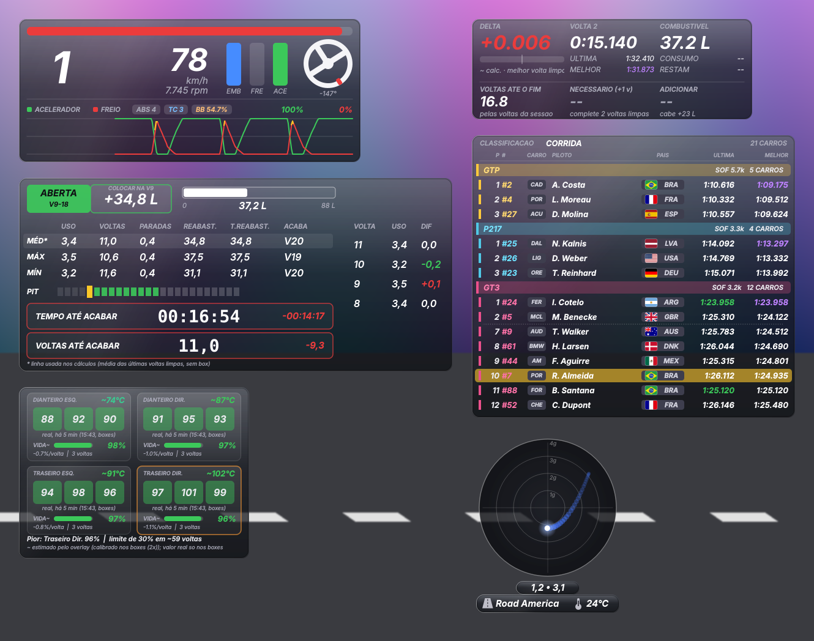

## 5. As janelas

### 1. Telemetria

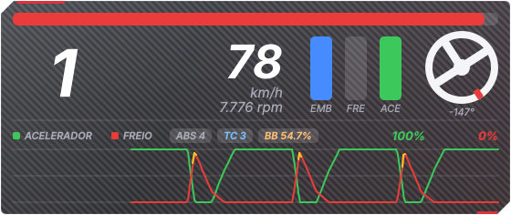

Marcha, velocidade, RPM, pedais (embreagem, freio, acelerador), volante girando como o real (marcador vermelho no topo; ângulo em graus: + esquerda, - direita) e gráfico de acelerador e freio dos últimos ~10 s.

- O gráfico pode ser escondido pelo menu da bandeja (a janela diminui).
- Barra superior = RPM em relação ao limite do carro.

**Layout em barra (novo na 1.4.1):** no menu da bandeja, marque "Layout em barra horizontal (na telemetria)" para trocar o painel por uma barra de uma linha só (620 × 88 px, bem compacta): volante, marcha, velocidade, pedais e gráfico lado a lado. Embreagem em **azul**, freio em **laranja** e acelerador em **verde**, com o valor de 0 a 100 embaixo de cada pedal (colunas finas). Desmarque o gráfico e a barra encolhe para 292 px. Desmarcando o layout, volta o painel de sempre.

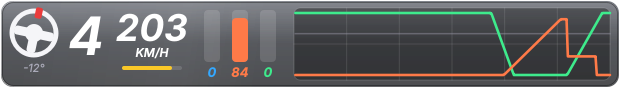

### 2. Voltas (delta, tempos e combustível)

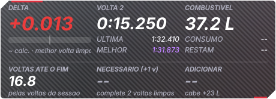

Delta para a melhor volta, tempos atual / última / melhor e uma faixa de cálculo de combustível.

- **Voltas até o fim**: em corrida por tempo, estima pelo ritmo (mediana das últimas voltas limpas).
- **Necessário (+1 v)** = (voltas até o fim + margem) x consumo médio. **Adicionar**: "OK" = termina com a folga; "+x,x L" amarelo = abastecer; vermelho = não cabe de uma vez.
- A margem (0,5 / 1 / 1,5 / 2 voltas) muda em *bandeja > Margem de segurança do combustível*.

### 3. Relativo

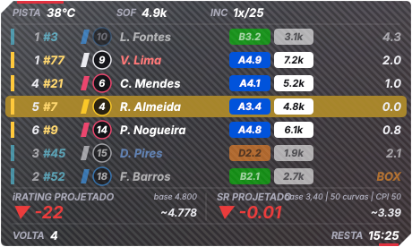

Carros à frente e atrás de você na pista, com classe, licença, iRating e distância em segundos, mais a projeção de iRating e SR.

- Sua linha fica em destaque. Linha apagada = outra classe; nome em vermelho = uma volta ou mais à frente; azul = uma volta ou mais atrás; "BOX" = nos boxes.
- A projeção de iRating/SR é **projetada, não oficial**, e é marcada como provisória até a confirmação.

### 4. Classificação

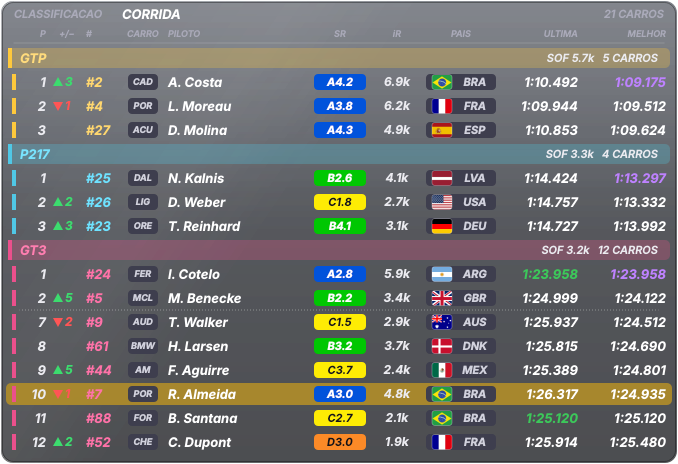

Carros agrupados por classe (da mais rápida para a mais lenta), com SOF da classe, número, marca, piloto, país, última e melhor volta.

- **+/− (novo na 1.4.2):** na corrida, seta **verde ▲** com o número de posições **ganhas** e seta **vermelha ▼** com as **perdidas** desde a largada (dentro da classe). Sem seta = mesma posição. A base é a ordem do grid no momento da bandeira verde; se o overlay abrir depois da largada, vale a primeira ordem vista. Fora de corrida a coluna fica vazia.

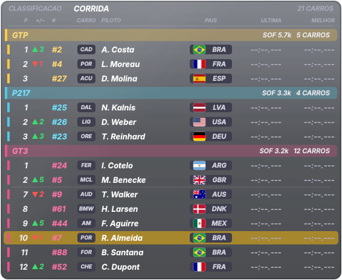

- Melhor volta em **roxo** = a mais rápida da classe. Última volta em **verde** = igualou a melhor do piloto.
- Na sua classe aparecem o topo e os carros ao seu redor; nas outras, os primeiros. Linha pontilhada = carros omitidos.
- Emblemas de marcas **não vêm no pacote** (marcas registradas): mostra as iniciais até você colocar suas próprias imagens em `overlay/emblemas/`.

### 5. Mapa da pista

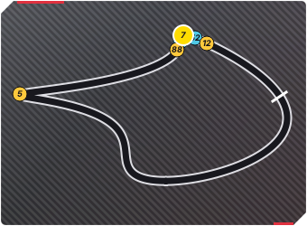

Traçado da pista com a posição de todos os carros (bolinhas com número e cor da classe; a sua é amarela e maior).

- O traçado é **aprendido na sua primeira volta limpa** em cada pista e fica salvo localmente.
- Se sair estranho: *bandeja > Refazer o mapa desta pista*.

### 6. Radar de proximidade

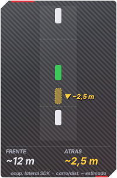

Visão de cima com seu carro no centro e os carros ao redor (alcance de ~20 m à frente e atrás).

- Branco = normal; amarelo = atenção; vermelho com brilho lateral = o iRacing avisa carro ao lado.
- O iRacing só informa **se** há carro ao lado, não a posição lateral exata; o radar é para prevenir contato, não para medir centímetros.
- **Radar automático (novo na 1.4.2):** a janela só aparece quando há carro a até 16 m ou o iRacing avisa carro ao lado, e some ~1,5 s depois. Desligue em *bandeja > Radar automático* para deixá-la sempre à vista. Com o overlay destravado (modo mover) ela fica sempre visível.
- **Carro ao lado:** faixa vermelha no topo (*CARRO A ESQUERDA / A DIREITA / DOS DOIS LADOS*) e o carro é desenhado **encostado** no seu, com o texto **AO LADO**. O iRacing não informa a distância lateral: o espaço entre os carros **nunca** é mostrado, e o "<0,5 m" de antes (distância de para-choque a para-choque, não lateral) deixou de aparecer nessa situação.

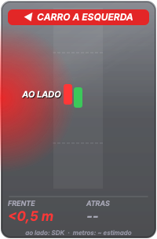

### 7. Pneus

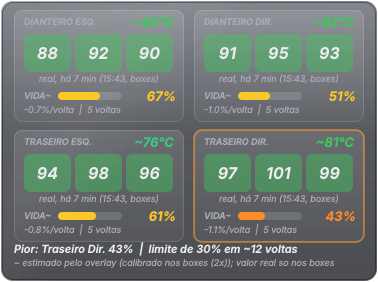

Vida útil e temperatura de cada pneu. O iRacing só informa valores reais com o carro parado no box; durante a corrida o overlay **estima**.

- Valor com "~" = estimado. A estimativa se calibra sozinha a cada parada nos boxes.
- Cores de temperatura: azul = frio; verde = ideal; amarelo = quente; vermelho = muito quente. Contorno laranja = pneu mais gasto.

### 8. Setores (vs melhor volta)

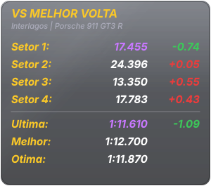

Compara cada setor com o **seu** melhor tempo para o mesmo carro e a mesma pista.

- Verde = mais rápido; vermelho = mais lento; roxo = novo melhor setor.
- A referência fica em `recordes_pessoais.json` (local).

### 9. Clima e vento

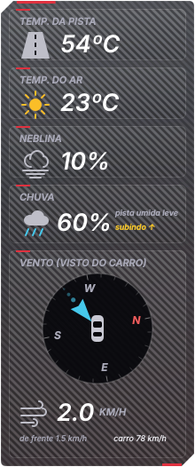

Temperatura da pista e do ar, neblina, chuva (atual + tendência) e bússola do vento vista do carro.

- A seta azul mostra para onde o vento sopra, relativo ao carro (para cima = vento de cauda).
- O iRacing **não** entrega previsão de chuva para programas externos.

### 10. Danos

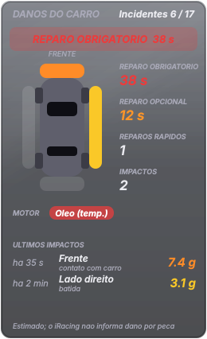

Reparo obrigatório/opcional (tempo informado pelo iRacing), incidentes, carro visto de cima com as zonas de impacto, avisos de motor e os últimos impactos.

- O iRacing não informa dano por peça. Direção e força dos impactos são **estimadas**.

### 11. Painel de combustível e pit

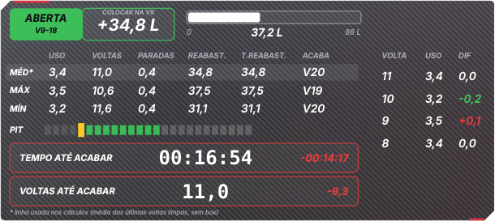

Janela de pit, litros a colocar, tabela de consumo (média, máximo, mínimo), barras de voltas possíveis para parar e tempo/voltas até acabar.

- Caixa colorida: **ABERTA** (verde) = pode parar nessas voltas; **FECHADA** (laranja) = cedo demais; **SEM JANELA** (vermelho) = sem plano viável.
- Estimativa baseada no seu ritmo recente; não prevê bandeira amarela.

### 12. Força G

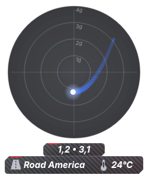

Círculo de G lateral e longitudinal com rastro, G atual e pico, nome e temperatura da pista.

- Cada anel = 1 g (alcance configurável de 2 a 5 g). Curva à esquerda leva o ponto para a esquerda; freando, o ponto desce.

### 13. Telemetria: gráfico de pedais (novo na 1.2.0)

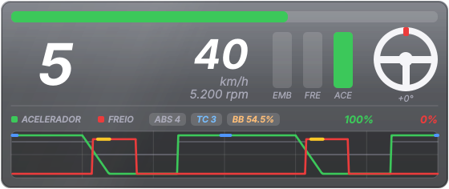

A janela Telemetria (a primeira, com marcha, velocidade, rpm, barras dos pedais e volante) ganhou um gráfico melhor: o **acelerador (verde) e o freio (vermelho)** correm da direita para a esquerda, como um espelho de como você pilota. Não há mais uma janela Inputs separada. Não grava nada no disco.

- **Tempo do gráfico:** de 5 a 30 segundos (padrão 12 s), em *bandeja > Telemetria: tempo do gráfico de pedais*.
- **Freio por cima do acelerador:** onde as duas linhas estão no alto ao mesmo tempo, você pisou os dois pedais juntos.
- **Marca do ABS (amarelo):** o trecho do freio em que o ABS atuou. Se cobre a freada inteira, você freou demais. Vem ligada.
- **Marca do TC (azul):** o trecho do acelerador em que as rodas patinaram. É **estimada** (veja a Luz do TC). Vem desligada.
- **De onde vêm os pedais:** *como chegam ao carro* (padrão, já com a calibração do seu pedal), *cru* (como o pé pisa) ou *os dois* (a diferença é a calibração do pedal).
- **Degraus da marcha:** uma linha cinza mostra em que marcha você estava a cada instante (liga e desliga na bandeja).
- Aparece pilotando; some na garagem, nos menus e nos replays (como as demais janelas no modo "aparecer sozinho").

### 14. Luz do ABS

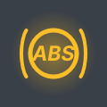

Um ícone solto, sem painel e sem texto, que **acende enquanto o ABS está atuando** e apaga quando ele para. No simulador você não sente o pedal vibrar; a luz mostra isso. Uma piscada curta no ponto de freada é o ABS trabalhando bem; acesa até o meio da curva, a freada passou do ponto.

- **Cor:** dourado (padrão), vermelho ou branco. **Como pisca:** *no ritmo do ABS* (padrão), *piscada suave* ou *luz fixa*.
- Quando não atua, a janela é **totalmente transparente**; para vê-la apagada (cinza) marque *deixar visível e apagada quando não atua* ou use *Testar a Luz do ABS (5 s)* na bandeja, útil para posicionar.
- Carros sem ABS: a luz simplesmente nunca acende. Dado **real** do iRacing (`BrakeABSactive`).

### 15. Luz do TC (perda de tração)

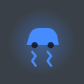

A luz do controle de tração na tela: **acende quando as rodas patinam na aceleração**. A cor padrão é o azul, de propósito diferente do dourado do ABS.

- **É uma estimativa.** O iRacing não informa quando o controle de tração corta. O overlay deduz pela relação entre as rotações do motor e a velocidade do carro em cada marcha: se o motor sobe sem o carro andar mais, as rodas patinam. Por isso pode deixar passar uma patinada muito pequena ou avisar a mais no limite.
- **Aprende o câmbio sozinho**, a cada marcha, enquanto você roda sem acelerar e sem frear forte. Marcha que ainda não aprendeu não acende a luz. Ao entrar numa sessão nova o aprendizado recomeça (o próximo carro pode ter outro câmbio).
- **Quando ela não olha:** pouco acelerador, freando, embreagem pisada, quase parado, até 0,4 s depois de uma troca de marcha, limitador dos boxes e corte de giro.
- **Sensibilidade:** *fina* (a partir de 3,5%), *normal* (5%, padrão) ou *grossa* (7,5%). Se a luz não para de acender, passe para grossa. Com pneus frios ela acende mais: é normal.
- Mesmas opções de cor, piscar, visível-apagada e teste (5 s) da Luz do ABS.

### 16. Retorno à pista (PARE / CEDA / LIVRE)

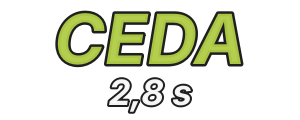

Você saiu da pista ou ficou atravessado: **entro agora ou espero?** O aviso diz PARE, CEDA ou LIVRE e quantos **segundos faltam para o carro mais próximo que vem atrás chegar** até você. Só aparece quando precisa e some sozinho.

| Palavra | Quando (padrão) | O que fazer |
|---|---|---|
| **PARE** | menos de 1,5 s | não entre, ele está em cima |
| **CEDA** | de 1,5 a 3,5 s | pode entrar, mas deixe ele passar |
| **LIVRE** | 3,5 s ou mais, ou ninguém em 30 s | entre tranquilo (acima de 30 s não aparece número) |

- A **cor** desliza do vermelho ao verde conforme sobram mais segundos (verde exatamente no limite do CEDA); o texto tem borda preta para ler sobre grama e brita.
- **Limites ajustáveis** na bandeja: vermelho de 1 a 12 s e laranja de 2 a 25 s. O laranja fica sempre pelo menos 0,5 s acima do vermelho; se você empurra um contra o outro, o outro se move sozinho. Ajuste ao seu carro: quanto mais tempo você leva para sair da brita e ganhar velocidade, maior deve ser o vermelho.
- **Quando aparece:** fora da pista, ou na pista quase parado (abaixo de 2 m/s, uns 7 km/h). Ao voltar a andar fica mais 1,5 s. **Nunca** no box nem no pit lane. *Deixar sempre visível enquanto piloto* é opcional; *Testar o aviso de Retorno (9 s)* percorre os três estados.
- **Como o número é calculado (~):** o overlay mede ao vivo o quanto cada carro avança na pista (não usa a média da volta, que erraria nas retas) e calcula o tempo para ele chegar onde você está. No primeiro instante, antes de conseguir medir, usa o tempo de volta estimado. Conta qualquer carro que vem atrás, também retardatário; ignora carros no pit lane, fora da pista ou praticamente parados, e o pace car.

### 17. Estratégia de pneus (chuva x seco)

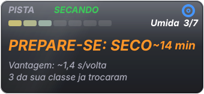

Diz qual pneu vale a pena agora e, antes da corrida, com qual largar. **Só lê dados**: nunca pede pneus nem mexe no carro.

- **Linha de cima:** para onde a pista vai (SECANDO, MOLHANDO, SEM CHUVA) e o pneu que você tem montado (azul = chuva, branco = seco). A tendência precisa de uns 90 s de leitura.
- **Nível da pista:** os sete níveis do iRacing, de *Seca* a *Encharcada*, com barra e número.
- **O que fazer:** **SEGUIR** (cinza), **PREPARE-SE** (laranja, com os minutos estimados quando a pista está secando), **TROCAR** (laranja, pulsando) e **PEDIDO NOS BOXES** (verde, quando você já pediu o pneu no menu de boxes do iRacing). O aviso só desce depois de 15 s, para não piscar.
- **Regras (padrão):** com pneu de chuva, TROCAR PARA SECO quando a pista chega a *Quase seca* sem chuva; com pneu de seco, TROCAR PARA CHUVA a partir de *Molhada* (ou *Pouco molhada* com chuva forte). Se pelo menos dois pilotos da sua classe já provaram que o outro pneu rende 1 s ou mais por volta, o aviso vira TROCAR.
- **Vantagem (~):** segundos por volta que o outro pneu rende, estimados com as últimas voltas limpas (sem passar pelo pit) dos pilotos da **sua classe** nos últimos 10 min. Sem rivais no outro pneu aparece "--". Só informação: nunca muda o aviso por si só. Também mostra quantos da sua classe já trocaram.
- **Antes da largada** (corrida em espera, ou classificação parado na garagem/boxes): *LARGUE COM SECO ✓* (verde) ou *PARA A LARGADA: TROQUE PARA CHUVA* (vermelho, pulsando). Nesse momento a janela aparece também na garagem.
- Carro sem pneu de chuva: mostra o aviso "Este carro não tem pneu de chuva".

### 18. Curvas (velocidade mínima por curva) — novo na 1.4.0

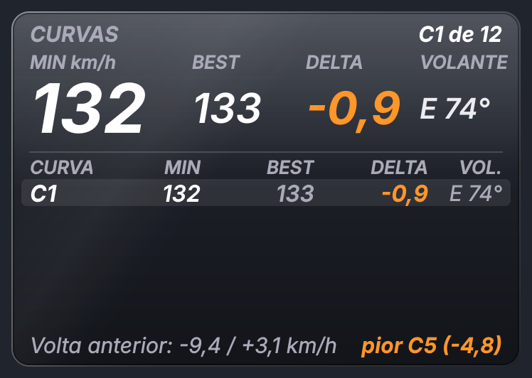

Mostra, para cada curva da pista, a **menor velocidade** que você fez e compara com a sua **melhor passagem** por ela. É a janela para descobrir **onde** a volta está sendo perdida: em qual curva, e quanto.

- **Cartão grande (última curva concluída):** **MIN** (menor velocidade nessa curva, em km/h), **BEST** (a maior velocidade mínima que você já fez nessa curva em voltas válidas), **DELTA** (MIN − BEST das voltas anteriores) e **VOLANTE** (graus do volante no ponto da velocidade mínima; **E** = esquerda, **D** = direita).
- **DELTA:** verde = mais rápido que a sua melhor passagem; branco = praticamente igual (menos de 0,5 km/h); laranja = perdeu um pouco; vermelho = perdeu 3 km/h ou mais.
- **Linhas:** as últimas 5 curvas desta volta, a mais recente em cima. **Rodapé:** o que a volta anterior perdeu e ganhou no total e a pior curva.
- **Como as curvas são achadas:** o overlay não conhece o traçado. Ele guarda a menor velocidade em cada trecho da pista nas suas voltas e marca como curva cada queda de velocidade seguida de recuperação (numeradas C1, C2... a partir da linha de chegada). A **primeira volta válida** cria o mapa; as três primeiras o refinam e depois ele **congela**. Tudo vem do carro (velocidade, volante, posição na volta); nada é estimado, mas o **mapa de curvas é uma inferência**: curvas muito suaves (que quase não reduzem a velocidade) não aparecem, e uma chicane rápida pode virar uma curva só.
- **Volta válida:** sem passar pelos boxes, sem sair da pista, sem parar, com a volta quase inteira medida e sem ser muito mais lenta que a melhor. Voltas inválidas não entram no BEST.
- **Valores só da sessão:** o aprendizado e o BEST valem para a sessão atual; ao mudar de sessão ou pista tudo recomeça. Use "Curvas: reiniciar o aprendizado desta pista" na bandeja para zerar na mão.
- Fonte: o menu da bandeja liga/desliga a janela; na build q ela também tem atalho global (Alt+F19) e botão na pasta *Telas novas* do Stream Deck.

### Onda 1 da 1.7.0 (build r): Consumo e Delta Trace

- **Consumo (Burn Zones + Fuel Flow):** faixa de 24 trechos da volta coloridos pelo consumo de cada um (vermelho = gasta bem mais que a média do trecho, verde = menos), faixa da volta atual logo abaixo, os 3 **trechos de maior consumo** (indicativo: gastar mais que a média do carro não quer dizer que há economia possível) e, ao lado, fluxo instantâneo (L/h), consumo médio e da última volta (L/volta) e a tendência. O fluxo é calculado pela variação do **nível** de combustível, igual nos dois jogos. Só voltas completas e limpas entram; com menos de 3 voltas limpas o painel mostra "mapeando N/3". **Leitura indicativa**: o overlay não estima litros que você economizaria.
- **Delta Trace:** o delta contra a melhor volta limpa **da sessão** ao longo da volta, no eixo do tempo (negativo = mais rápido, mesmo sinal do delta do jogo). Verde = ganhando, vermelho = perdendo; o traço tracejado é a volta anterior (sempre recalculada contra a referência vigente). Abaixo do gráfico há um **bloco por curva**: quanto mais tempo você passa na curva, mais largo é o bloco; verde/vermelho/cinza = ganhou/perdeu/igual (curvas ainda não feitas ficam apagadas). À direita: o **número da curva** ("CURVA" = a que você está fazendo, "PRÓXIMA CURVA" = a próxima), o delta parcial dela e o desenho da pista no estilo do Minimapa; o trecho já percorrido fica **verde onde você ganhou tempo e vermelho onde perdeu**, com a curva em foco destacada. Precisa do Mapa já aprendido (uma volta completa); sem ele aparece só o número. Sem volta limpa ainda: "sem referência".
- **Delta Trace, layout:** em *Central > Delta Trace > Layout do painel* escolha **Gráfico ao longo da volta** (padrão) ou **Estilo RaceLab**: número grande no centro e uma barra horizontal a partir do zero (verde para a esquerda = ganhando; vermelho para a direita = perdendo). Os blocos por curva e o desenho da pista aparecem nos dois. Com muitas curvas (até ~30) os blocos ficam mais estreitos e passam a mostrar só a cor. Em *Elementos do Delta Trace* você liga ou desliga, como nas colunas da Classificação, o título/referência, o delta grande, o gráfico (ou a barra), a volta anterior tracejada, os blocos por curva, o número da curva e o desenho da pista; a prévia e a janela mudam na hora e a janela encolhe junto.
- **Atalhos:** o Consumo, o Delta Trace e a Janela de curvas têm atalho global (Alt+F17, Alt+F18 e Alt+F19; ver `overlay/ATALHOS_STREAM_DECK.txt`) e uma pasta **Telas novas** no perfil do Stream Deck.

### Janelas automáticas da 1.5.0: Bandeiras, Tráfego, Minimapa e Auxiliar

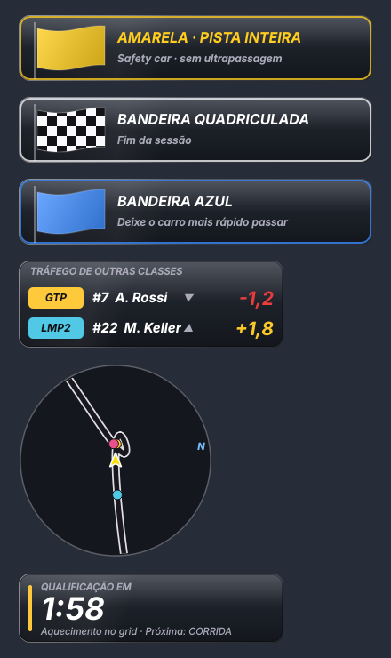

| Janela | Quando aparece | O que mostra |
|---|---|---|
| **Bandeiras** | só com bandeira | verde (6 s), amarela, amarela de pista inteira, azul, branca, quadriculada, preta/desclassificado, vermelha |
| **Tráfego** | só com carro de outra classe a até ~6 s | classe, #número, piloto e diferença em s (▼ atrás, ▲ à frente) |
| **Minimapa** | sempre | pista girando ao seu redor; carros na cor da classe; "N" = norte; alcance 150/260/400 m no menu |
| **Auxiliar** | antes da largada e no fim | etapa da sessão, contagem, duração; "também durante a sessão" mostra o tempo restante |

Destravadas (modo mover), as janelas automáticas mostram um exemplo para você posicionar. Os segundos do Tráfego são calculados (velocidade e distância na pista); o traçado do Minimapa é aprendido na primeira volta.

### Central de configurações (1.6.0)

Duplo clique no ícone da bandeja (ou "Abrir configurações…"):

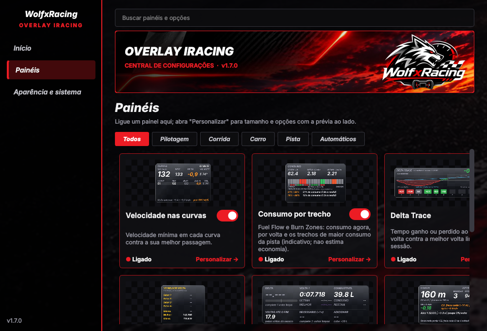

- **Elementos (build u):** os painéis *Curvas, Setores, Coach, Consumo, Tendência* e *Voltas* têm, em *Personalizar > ELEMENTOS*, um interruptor por parte da janela. Desligar uma parte encolhe a janela e sobe as partes de baixo; "Mostrar todos" restaura. A prévia ao lado mostra o resultado na hora. Em *Voltas*, as colunas desligadas ficam vazias (sem reaproveitar o espaço).
- **Painéis:** um cartão por janela com prévia, liga/desliga e "Personalizar"; busca e filtros por categoria.
- **Personalizar:** tamanho, opções do painel e prévia ao vivo.

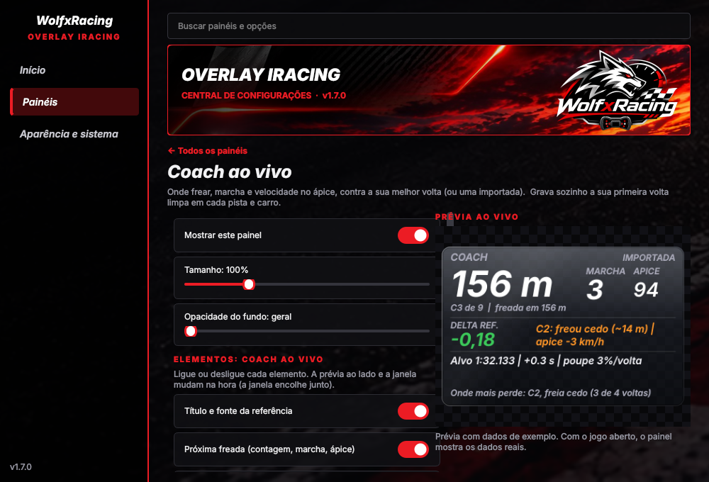

- **Aparência e sistema:** opacidade, vidro, travar posição, economia de CPU, prioridade, atalhos.
- **Perfis:** automático, treino, classificação ou corrida.

O menu da bandeja ficou curto; todas as opções antigas estão em "Todas as opções (avançado)".

### Tendência de ritmo (1.6.0)

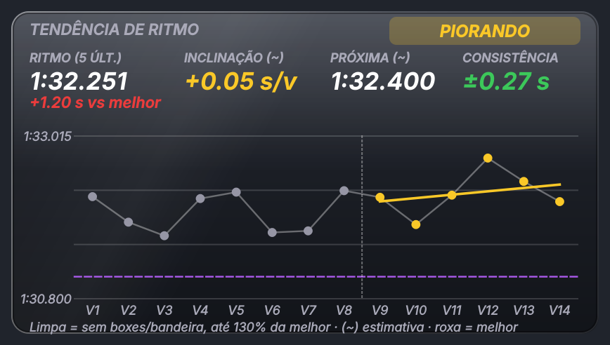

- **Volta limpa:** sem passar pelos boxes, sem bandeira amarela/vermelha durante a volta e até 130% da sua melhor volta. Só essas voltas entram na conta.
- **Ritmo (5 últ.):** média das 5 últimas voltas limpas e a diferença para a sua melhor.
- **Inclinação (~):** quanto o ritmo muda por volta no stint atual (negativo = melhorando; abaixo de 0,03 s/volta = estável). Precisa de 4 voltas limpas no stint. É uma estimativa (regressão linear).
- **Próxima (~):** tempo esperado da próxima volta se o ritmo continuar nessa direção. Estimativa.
- **Consistência:** desvio das últimas 8 voltas limpas (± segundos).
- No gráfico, a linha pontilhada vertical marca a passagem pelos boxes (novo stint) e a linha roxa é a sua melhor volta.

### Último contato e Entrada do pit (1.6.0)

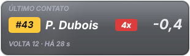

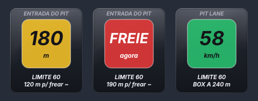

- **Último contato:** aparece depois que você toca em um carro; mostra o piloto, a volta, há quanto tempo e a diferença atual (− atrás, + à frente).
- **Entrada do pit:** verde → amarelo → vermelho (**FREIE**) conforme a distância de frenagem até o limite; na pit lane mostra a velocidade contra o limite e a distância até o box. A frenagem usa 1,2 g: é uma estimativa. **Só aparece quando você pede a entrada** (atalho `Ctrl+Alt+F23` = pedir, `Ctrl+Alt+F24` = cancelar, ou menu da bandeja: *Pit: pedir/cancelar a entrada*; **Stream Deck:** no botão "Pitting In" use uma *Multi Ação* com o comando de chat do iRacingSFX e, em *Sistema > Atalho*, `Ctrl+Alt+F23` (o overlay não lê o chat do iRacing); o pedido some sozinho ao entrar na pit lane) ou com *Pit: mostrar sempre*. A linha de entrada é aprendida quando você entra de verdade pelo pit (acima de 36 km/h, vindo da pista); nascer no box não conta. Se a pista já tinha um aprendizado errado, o overlay descarta (arquivo novo `pit_entradas_v2.json`).

### Classificação com SR e iR (1.6.0)

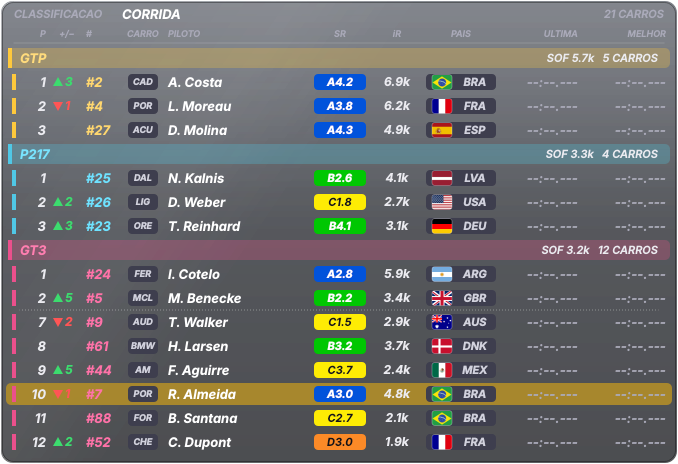

## 6. Como ler os números: real, calculado, estimado

- **Sem marca** = **real**, entregue pelo iRacing (velocidade, marcha, RPM, pedais, volante, força G, combustível no tanque, clima, reparo e avisos do motor).
- **"~"** = **calculado ou estimado** pelo overlay (consumo por volta, voltas/litros até o fim, tempos de setor, distâncias no radar, temperatura e vida dos pneus durante a corrida, lado e força dos impactos, iRating e SR projetados, **Luz do TC**, **segundos do Retorno à pista** e **vantagem dos pneus**).
- O iRacing **não informa**: quando o controle de tração corta (a Luz do TC é uma dedução), se uma volta foi invalidada, a posição lateral dos outros carros, a previsão de chuva, dano por peça e o iRating/SR oficial durante a sessão. Nada disso é inventado pelo overlay.
- **Delta e setores:** o iRacing não diz se a volta foi invalidada; o overlay usa um critério próprio e conservador.

## 7. Dash e Stream Deck

- **Dash MagicDash 4 Glass Fumê ou Sport** (3 telas): veja [DASH.md](DASH.md).
- **Perfil de Stream Deck XL** (janelas, controles, iniciar/fechar, pasta Suporte): veja [STREAMDECK.md](STREAMDECK.md).

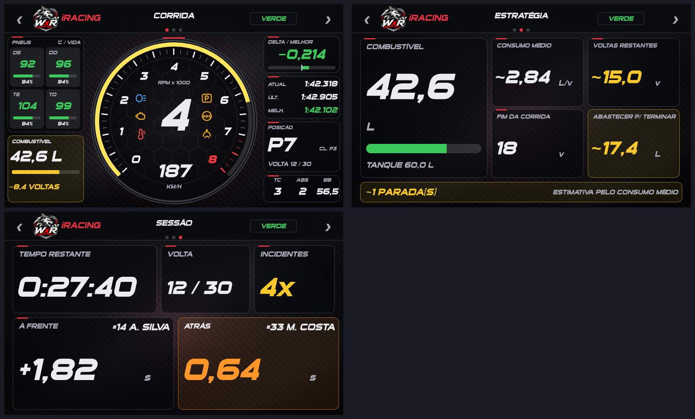

## 8. Solução de problemas

| Sintoma | O que fazer |
|---|---|
| "Falta o arquivo ov_nucleo.py" ou "ov_v12.py" | Copie **todos** os arquivos de `overlay/` para a mesma pasta. |
| O overlay não abre | Abra `overlay\overlay_log.txt` e anexe-o em uma Issue. |
| "Aguardando o iRacing..." | O jogo precisa estar aberto e dentro de uma sessão. |
| Não aparece sobre o jogo | Use **janela sem bordas** (seção 3). |
| Uma janela mostra "Sem dados" | Normal em menus/garagem. Se persistir na pista, anexe o log em uma Issue. |
| Classificação vazia em treino | Carros sem tempo válido ainda não entram na lista. |
| Esquerda e direita trocadas (pneus, danos, força G) | Com o overlay fechado, ponha `"pneu_lado_invertido": true` no `config.json`. |
| Seta do vento invertida | `"vento_invertido": true` no `config.json`. |
| Um atalho do Stream Deck não funciona | Outro programa pode estar usando a combinação; veja o log (`overlay_log.txt`). |
| Valor estranho | Anote a janela e a situação (treino/corrida/carro) e abra uma Issue com o log. |

## 9. Atualizar para uma versão nova

1. Feche o overlay (*Sair* na bandeja).
2. Baixe o novo `.zip` e **copie por cima** da pasta atual (o `config*.json`, recordes, mapas e logs ficam e continuam valendo, pois não vêm no pacote).
3. Leia o [CHANGELOG](../CHANGELOG.md) para ver o que mudou. Reabra o overlay.

## 10. Limites conhecidos

- A estimativa de temperatura e vida dos pneus é uma **estimativa**: antes da primeira calibração (1ª parada nos boxes) pode errar bastante; depois serve bem para comparar e acompanhar a tendência.
- A **Luz do TC** e a **vantagem dos pneus** são estimativas; a **Estratégia de pneus** usa regras simples sobre o nível de umidade do iRacing e ainda precisa de validação em chuva real. Os novos overlays não têm atalhos de teclado do Stream Deck nesta versão (use o menu da bandeja).
- O radar não conhece a posição lateral dos outros carros (limitação do iRacing).
- Em tela cheia exclusiva nenhum overlay aparece (limitação do Windows).
- Os testes automáticos usam dados simulados; a validação real depende do uso em sessões do iRacing (veja `overlay/ROTEIRO_VALIDACAO.txt`).

Mais detalhes técnicos de cada recurso: [`referencia/GUIA_ORIGINAL.txt`](referencia/GUIA_ORIGINAL.txt) (guia completo escrito durante o desenvolvimento).

### Classificação no layout de transmissão e versão EXE (1.6.1)

A janela Classificação ganhou o layout de tabela de transmissão: barra superior (sessão, volta, tempo, AIR/TRACK/HUM, incidentes/limite e estado da pista) e as colunas POS, +/-, #, pneu, LIC · iR (com a variação de iRating projetada), marca, bandeira, DRIVER, GAP, INT, BEST, LAST, PIT e STINT. Seu carro fica em roxo.

- **GAP e INT na corrida são estimativas** (posição na pista × tempo de volta típico da classe); em treino e qualificação são a diferença das melhores voltas.
- **PIT** conta paradas completas na vaga; **STINT** são as voltas desde a última parada ("~" = aproximado se o overlay abriu depois da largada).
- Para voltar ao visual antigo, use `"classificacao_layout": "classico"` no `config.json`; para rótulos em português, `"classificacao_idioma": "pt"`.
- **Versão EXE:** baixe `WolfxRacing_iRacing_vX.Y.Z_EXE.zip` na release, extraia e abra `WolfxRacing_iRacing.exe` (não precisa de Python). `testar_demo_exe.bat` abre em modo demonstração e `fechar_overlay_exe.bat` fecha à força. Para gerar no seu PC: `overlay\gerar_exe.bat`.

## Novidades da 1.7.0 (prints)

Coach ao vivo, Delta Trace (com o *ritmo ideal estimado*), Consumo, Curvas e Tendência, e a Central com **Elementos** liga/desliga e prévia ao vivo (imagens geradas com dados de exemplo).

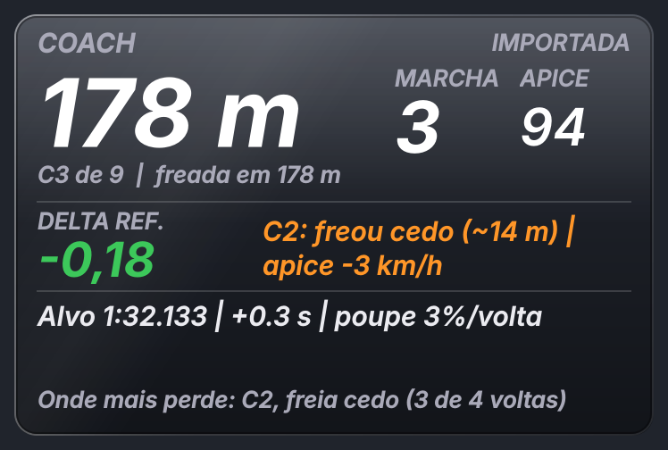

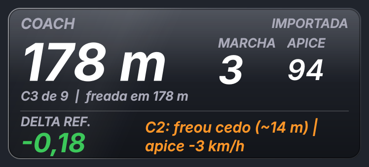

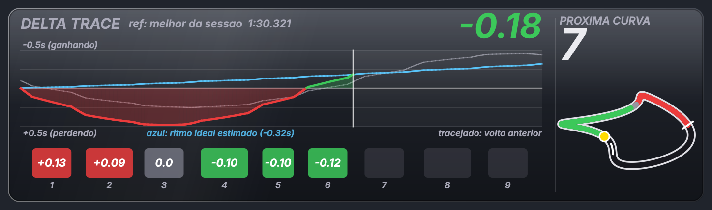

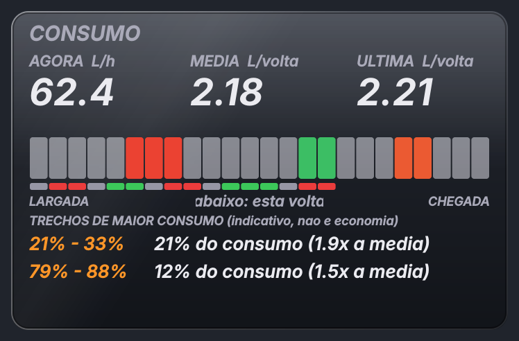

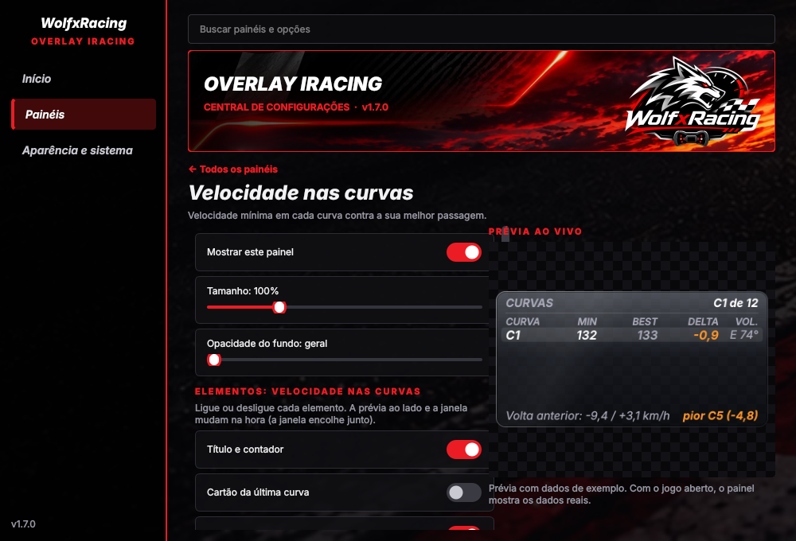
